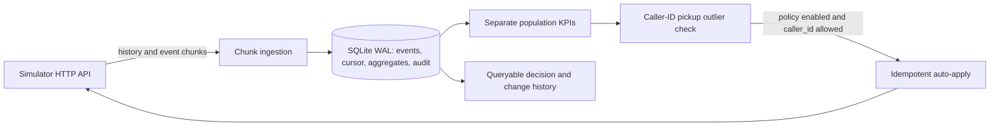

# Outcome-First Agent Loop — Submission

**Name:** Not provided · **Date:** 2026-11-08 · **Hours actually spent:** about 0.5 in this session · **Language / storage:** Python, SQLite

## 0. TL;DR

The controller ingests compressed event chunks idempotently, maintains normalized hourly KPI aggregates, detects caller-ID and prompt incidents, preserves supervisor-owned changes, runs fixed-horizon randomized experiments, and reconciles approval proposals. Public_02 completed with 6.3% aggregate conclusion-rate lift and zero governance violations. Public_03 was not rerun after the storage redesign because automatic review rejected a multi-gigabyte run with about 2.7 GiB free; no load pass is claimed.

## 1. Assumptions

1. The simulator API contract in `docs/SIMULATOR.md` is authoritative; all controller decisions use only HTTP responses and its own persisted event ledger.
2. A controller restart does not restart the simulator. The controller uses the globally increasing chunk number and event ID to recover.
3. Caller-ID pickup comparisons are meaningful only after at least 100 calls on the candidate and comparison populations; an 8 percentage point observed gap is a conservative incident trigger, not proof of causality.
4. SQLite is appropriate for this single-process assignment implementation. Multi-process production ingestion would need a shared transactional store.

## 2. Scope decisions

| # | Capability | Built / Partial / Cut | Why | What it would take to finish |
|---|---|---|---|---|
| C1 | Event ingestion | Partial | Compressed raw chunks and bounded-memory line ingestion; public_02 storage measured. Public_03 scale remains unverified. | Run public_03 in a safely provisioned environment. |
| C2 | Shared cohorts | Cut | No cohort reassignment or supervisor view was implemented. | Persist lead features and use the simulator cohort IDs consistently. |
| C3 | History bootstrap | Built | History chunks are ingested before the first advance. | Add explicit historical aggregates by cohort and variant. |
| C4 | Call-time optimisation | Cut | Avoided changing business scheduling without validated counterfactuals. | Cohort-level experiments and schedule replay. |
| C5 | Caller-ID health | Built | Rolling 24-hour sample-gated caller comparison, policy-bound allocation change, post-change KPI verification and rollback proposal on degradation. |
| C6 | Variant experimentation | Built | Fixed 48-hour randomized 80/20 allocation, minimum sample thresholds, a single confidence look and independent guardrail. |
| C7 | Winner promotion / rollback | Partial | Promotion requires statistical evidence and a guardrail pass; promoted candidates are monitored and rollback proposals are created after degradation. Public_02 did not complete a promotion cycle. |
| C8 | Hallucination response | Built | Prompt incident detection, bounded suggestion and validation, approval proposal and post-apply verification with rollback path. |
| C9 | Governance client | Partial | Durable proposals, approval reconciliation, expiry/lapse/stale handling and idempotent action IDs; crash fault-injection coverage remains incomplete. |
| C10 | Impact / dry run | Partial | Proposals include a full diff, affected-lead estimate, rationale and dry-run evidence; impact estimates are heuristic and labeled. |
| C11 | Supervisor view | Cut | The SQLite audit ledger is queryable but has no UI/API. | Read-only dashboard over the ledger. |
| C12 | Audit store | Built | SQLite records events, checkpoints, observed KPIs and decisions. | Add retention policy and access controls for production. |
| C13 | Crash recovery | Partial | Public_01 was interrupted and resumed with the same SQLite DB; recovery evidence is documented in `reports/crash_recovery.md`. | Repeat automated fault injection around approval/apply boundaries. |
| C14 | Observability | Partial | Audits include chunk counts, per-workflow KPI populations and checkpoints. | Export lag, rates, latency, credits and paging metrics. |
| C15 | Fair credit / attention allocation | Cut | No LLM/validation credits are spent. | Tenant-aware scheduling once those calls are added. |

The scope prioritizes durable observation and a narrow, policy-checked operational intervention over a broad but unverified learning loop. No prompt, voice or welcome-message winner is inferred from non-random historical data.

## 3. Stakeholders

### 01 — Sales

Accepted the need to show an outcome separately for each workflow. Declined a blended score, instant promotion, and universal auto-apply: the contract maintains separate pickup and engagement metrics, and policy is workflow-specific. The memo's claims about Kestrel auto-apply for everything and Northwind KYC permission are not reliable; the controller reads the API workflow policy. No prompt from another account is deployed.

**Reply:** We can report pickup, engagement and concluded-lead outcomes separately. A workflow only receives automatic changes where its signed policy permits the exact dimension and shift. We will not roll a prompt or customer-facing variant across accounts based on a demo. The first release makes only a narrow operational caller-ID adjustment when a sufficiently large observed population shows a clear pickup gap; all other changes wait for evidence and the required approval path.

### 02 — Compliance

Accepted named approval for agent-facing changes, validation evidence for prompts, per-call event retention, and approver hours as governance constraints. The controller currently makes no customer-facing changes; operational auto-apply is still checked against each workflow's actual policy.

**Reply:** The controller retains raw events in compressed chunks and maintains workflow, cohort, config version and variant aggregates. Prompt changes require validation evidence and approval; voice and welcome changes follow live workflow policy. The SQLite audit ledger is operator-queryable; a supervisor-facing interface remains a production prerequisite.

### 03 — Platform & SRE

Accepted SQLite, event idempotency, restart recovery and the need for actionable audit data. The restarted public_01 run is the recovery evidence. Load-scale performance and external metrics export remain unverified.

**Reply:** State is in a WAL-mode SQLite database with synchronous commits, a unique event ID, a durable chunk cursor and an audit table. A controller restart re-reads chunks after the last checkpoint and safely ignores duplicate event IDs. I am measuring the public load scenario before making a throughput claim. Before production, I would export ingest lag, decision latency and credit usage to the existing metrics stack and test concurrent recovery on the target host.

### 04 — Kestrel Operations

Accepted that supervisor changes must not be silently overwritten; current code reads live config before a policy-permitted update. No requests are generated, so the two-per-day and 11:00 boundaries are not crossed. No compliance-script or prompt changes are made. The consolidated screen is cut.

**Reply:** Supervisor changes remain visible in the event stream. Approval proposals include a base version and reconcile stale configs before applying. Supervisor voice edits abort pending voice tests; prompt edits trigger QA-based incident handling. Public_02 exercised the prompt and caller-ID incident paths while preserving the supervisor voice change.

### 05 — Product

Accepted separate KPI definitions and the principle that only run arms are evidence. No experimental cohorts or winner claims are present, so minimum cohort size, multiple-testing corrections and false-winner rate are not applicable. No impact score is fabricated.

**Reply:** Controlled experiments use a 48-hour 80/20 randomized allocation and one fixed statistical look. Each arm needs 300 dials; engagement-primary tests also need 100 connected calls per arm. Promotion requires a 2 point primary lift at z ≥ 2.58 and an independent guardrail pass. Proposals include affected-lead estimates and dry-run context; estimates are heuristic, not causal forecasts.

### 06 — CTO

Accepted explainability, finite-credit discipline and deliberate scope cuts. No LLM or validation credits are consumed. The current implementation is an observation and caller-ID guardrail loop, not the complete autonomy product.

**Reply:** The controller now has deterministic experiments and a governed approval loop. Remaining gaps are public_03 scale validation, crash fault-injection around approvals, and resolving incident/proposal states that remain pending at the scenario horizon.

## 4. Architecture



On restart, the service reads the saved cursor, asks the API for chunks after it, and deduplicates on `event_id`. The current automatic caller-ID path uses a stable proposal UUID per workflow/version/detection cursor. Unknown outcomes from the simulator advance request are reconciled against simulator time and event chunks.

## 5. The learning loop

Caller-ID detection uses a rolling 24-hour window and requires 100 dials per caller, 300 overall, an 8 percentage point pickup gap and more than 3.3 standard errors. It acts only when mid-flight changes and the specific caller-ID auto-apply dimension are allowed, and does not touch supervisor-edited dimensions or cohort-specific caller overrides. Rotations obey the workflow maximum-shift policy and project pickup and engagement separately.

Voice and welcome-message experiments use a controlled 80/20 allocation in an existing cohort, run for 48 hours, and take one fixed statistical look. Each arm needs 300 dials; engagement-primary tests also need 100 connected calls per arm. Promotion requires at least a 2 point primary lift and z ≥ 2.58. The independent guardrail must also pass its one-sided 95% bound. Underpowered or unsupported candidates return to control. Promoted variants are monitored for a 2 point primary degradation and then submitted for rollback under the same policy.

## 6. Governance

Every proposal has a stable idempotency key, base config version, proposed config, rationale and a full diff. Approval proposals include affected-lead estimates, dry-run context and validation evidence when required. The controller reconciles pending/approved/rejected/expired/lapsed states, checks stale base versions before application, and records application or lapse outcomes. Auto-apply requires enabled policy, every changed dimension in the allowed set, mid-flight permission and shifts within the policy maximum. Crash fault-injection coverage and automatic re-proposal after stale conflicts remain incomplete.

## 7. Incidents

Caller-ID detection uses rolling-window samples (100 dials per side, 300 overall, 8 point observed gap). Public_02 rotated the flagged `ks_cancel` DID. Prompt incidents use event and QA evidence, validated suggestions, approval and post-change checks. Supervisor voice edits abort pending voice tests instead of being overwritten. Caller post-verification detected engagement regression; the follow-up code now submits a policy-checked rollback proposal, but this final rollback branch has not been rerun end to end.

## 8. Scale

Public_03 earlier failed after simulator history consumed 2.3 GiB and the controller hit disk-full with 117 MiB free; failed-bootstrap RSS was 556,138,496 bytes over 4.64 seconds. Compact storage measured 10,412,032 database bytes for 324,308 public_02 events, but a fresh public_03 run was rejected by automatic review with about 2.7 GiB free. No full-scale throughput or memory result is claimed. See `reports/public_03.md`.

## 9. Reliability

The controller commits compressed event chunks, metric aggregates and chunk cursor transactionally. A unique primary key on `event_id` makes replay idempotent. SQLite uses WAL and `synchronous=FULL`. Idempotent GET/PUT calls retry up to four times with exponential backoff; simulator advance is not blindly retried because it mutates time, and uncertain progress is reconciled against `/sim/state` and event chunks. HTTP 4xx responses are handled as non-retryable outcomes. Crash recovery evidence is in `reports/crash_recovery.md`.

## 10. Audit & observability

Example query:

```sql
SELECT ts, action, details FROM audit
WHERE workflow_id = 'nw_renewal'
ORDER BY id;
```

This shows observed versions, population KPI snapshots and any attempted change with its evidence. Current audit records do not include a supervisor-facing API, and the per-call event records retain the simulator's config version, cohort and variant. Actionable production alerts would include a stuck chunk cursor, repeated API failure and a policy-denied action; ordinary hourly KPI snapshots should not page.

## 11. Results

The upgraded controller completed fresh public_01 and public_02 runs graded against no-op baselines; exact output is in `reports/public_01.md` and `reports/public_02.md`. Public_01 gained 2.5% conclusion rate; public_02 gained 6.3%. Public_03 remains unverified at load scale; its prior failure and review rejection are in `reports/public_03.md`.

### public_01_dev

| workflow | conclusion rate | Δ | pickup | Δ | engagement | Δ | engagement gap captured | hallucinated calls (base) |
|---|---:|---:|---:|---:|---:|---:|---:|---:|
| ks_cancel | 0.354 | +3.7% | 0.242 | -1.2% | 0.513 | +4.4% | 15% | 53 (57) |
| nw_kyc | 0.361 | -1.5% | 0.242 | +0.1% | 0.592 | -0.9% | 0% | 31 (21) |
| nw_renewal | 0.430 | +3.3% | 0.262 | -0.8% | 0.558 | +3.0% | 6% | 44 (54) |
| ALL | 0.381 | +2.5% | 0.249 | -0.8% | 0.544 | +2.8% | 8% | 128 (132) |

### public_02_incidents

| workflow | conclusion rate | Δ | pickup | Δ | engagement | Δ | engagement gap captured | hallucinated calls (base) |
|---|---:|---:|---:|---:|---:|---:|---:|---:|
| ks_cancel | 0.281 | +19.2% | 0.201 | +10.7% | 0.492 | +5.2% | 24% | 92 (348) |
| nw_kyc | 0.369 | -1.2% | 0.236 | +0.7% | 0.597 | -1.9% | 0% | 25 (29) |
| nw_renewal | 0.437 | +0.8% | 0.264 | +0.7% | 0.553 | -0.2% | 8% | 54 (54) |
| ALL | 0.351 | +6.3% | 0.229 | +4.5% | 0.537 | +0.9% | 13% | 171 (431) |

## 12. Trade-offs & rejected alternatives

| Option | Why considered | Why rejected / what instead |
|---|---|---|
| Push all traffic to yesterday's best arm | Fast apparent lift | No randomized evidence; high false-winner and cohort-harm risk. |
| LLM-selected winner | Flexible | Nondeterministic and disallowed for winner selection. |
| Prompt tuning during incidents | Could improve safety | Requires validation credits, evidence, approval and post-change verification; implemented and exercised in public_02. |
| Postgres/Redis | Familiar production infrastructure | SQLite keeps the assignment small and restartable; load test remains necessary. |

## 13. Known weaknesses

Public_03 is not validated at full scale. Public_02 ended with caller incident verification reporting a primary KPI regression and one active experiment at the horizon. Statistical stopping is one fixed look after 48 hours (300 dials per arm and 100 connected per arm for engagement-primary tests); underpowered tests remain inconclusive. Caller incident verification is conservative and may trigger rollback on early traffic. Production use needs more crash injection and a shared durable store.

## 14. If this went to production at Formi next month

1. Provision and measure public_03 safely, then set audit retention and access controls.
2. Add crash fault injection around proposal creation, approval, apply and rollback.
3. Resolve proposal and incident states that remain pending at a scenario horizon.
4. Calibrate dry-run impact estimates and caller post-change verification windows.
5. Export service metrics and deploy behind a tenant-by-tenant feature flag.

### Public results summary

| Scenario | Workflows | Conclusion outcome Δ | Pickup / engagement Δ | Controller changes | Governance |
|---|---:|---:|---:|---:|---|
| public_01 | 3 | +2.5% | -0.8% / +2.8% | 10 | 0 violations |
| public_02 | 3 | +6.3% | +4.5% / +0.9% | 16 | 0 violations |

Public_02 reduced hallucinated calls from 431 to 171 and improved aggregate conclusion rate by 6.3%. The caller-ID post-change verifier detected engagement regression; that run ended before the newly added rollback-proposal branch was implemented, so rollback is not claimed as exercised. Its experiment records include four rollbacks, one supervisor-aborted voice test and one active test at the horizon. Public_03 remains unverified.
