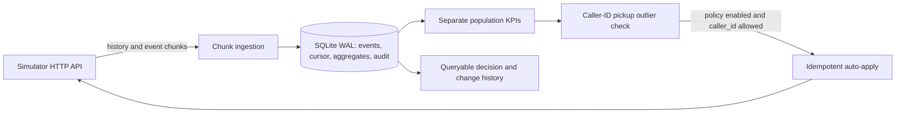

# Outcome-First Agent Loop — Submission

**Name:** Not provided · **Date:** 2026-11-08 · **Hours actually spent:** about 0.5 in this session · **Language / storage:** Python, SQLite

## 0. TL;DR

The controller ingests history and event chunks idempotently, persists an audit ledger, calculates pickup and engagement separately, detects population-level caller-ID pickup outliers, and rotates only through policy-permitted auto-apply. Public_01 completed after a mid-run restart with no changes or governance violations (0% lift). Public_02 completed and detected the scenario incidents in the grader report, but did not remediate them. Experiments, prompt remediation and general approval proposals are deliberately not claimed as complete.

## 1. Assumptions

1. The simulator API contract in `docs/SIMULATOR.md` is authoritative; all controller decisions use only HTTP responses and its own persisted event ledger.
2. A controller restart does not restart the simulator. The controller uses the globally increasing chunk number and event ID to recover.
3. Caller-ID pickup comparisons are meaningful only after at least 100 calls on the candidate and comparison populations; an 8 percentage point observed gap is a conservative incident trigger, not proof of causality.
4. SQLite is appropriate for this single-process assignment implementation. Multi-process production ingestion would need a shared transactional store.

## 2. Scope decisions

| # | Capability | Built / Partial / Cut | Why | What it would take to finish |
|---|---|---|---|---|
| C1 | Event ingestion | Partial | Durable, idempotent chunk ingestion; full load scale not yet verified. | Profile public_03, add incremental SQL aggregates and batching. |
| C2 | Shared cohorts | Cut | No cohort reassignment or supervisor view was implemented. | Persist lead features and use the simulator cohort IDs consistently. |
| C3 | History bootstrap | Built | History chunks are ingested before the first advance. | Add explicit historical aggregates by cohort and variant. |
| C4 | Call-time optimisation | Cut | Avoided changing business scheduling without validated counterfactuals. | Cohort-level experiments and schedule replay. |
| C5 | Caller-ID health | Partial | Workflow-level sampled pickup outlier can be reduced using permitted auto-apply. | Add recovery/decay logic, time-windowed rates and richer health signals. |
| C6 | Variant experimentation | Cut | Current initial allocations do not provide a randomized experimental design. | Randomized allocation, stratification, minimum sample design and correction for multiple comparisons. |
| C7 | Winner promotion / rollback | Cut | No statistically sound winner promotion exists without an experiment. | Sequential monitoring and rollback with guardrails. |
| C8 | Hallucination response | Cut | Detector flags are noisy; no prompt change is made without validation and approval evidence. | Bounded LLM/validation budget, evidence linking, approval and post-change QA. |
| C9 | Governance client | Partial | Checks policy before a narrow auto-apply. Approval proposals, polling, expiry, lapse and stale re-proposal are not implemented. | Batching, approver-hours scheduling, complete lifecycle retries and stale re-proposal. |
| C10 | Impact / dry run | Cut | No speculative impact scores are emitted. | Historical cohort replay and calibrated outcome estimates. |
| C11 | Supervisor view | Cut | The SQLite audit ledger is queryable but has no UI/API. | Read-only dashboard over the ledger. |
| C12 | Audit store | Built | SQLite records events, checkpoints, observed KPIs and decisions. | Add retention policy and access controls for production. |
| C13 | Crash recovery | Partial | Public_01 was interrupted and resumed with the same SQLite DB; recovery evidence is documented in `reports/crash_recovery.md`. | Repeat automated fault injection around approval/apply boundaries. |
| C14 | Observability | Partial | Audits include chunk counts, per-workflow KPI populations and checkpoints. | Export lag, rates, latency, credits and paging metrics. |
| C15 | Fair credit / attention allocation | Cut | No LLM/validation credits are spent. | Tenant-aware scheduling once those calls are added. |

The scope prioritizes durable observation and a narrow, policy-checked operational intervention over a broad but unverified learning loop. No prompt, voice or welcome-message winner is inferred from non-random historical data.

## 3. Stakeholders

### 01 — Sales

Accepted the need to show an outcome separately for each workflow. Declined a blended score, instant promotion, and universal auto-apply: the contract maintains separate pickup and engagement metrics, and policy is workflow-specific. The memo's claims about Kestrel auto-apply for everything and Northwind KYC permission are not reliable; the controller reads the API workflow policy. No prompt from another account is deployed.

**Reply:** We can report pickup, engagement and concluded-lead outcomes separately. A workflow only receives automatic changes where its signed policy permits the exact dimension and shift. We will not roll a prompt or customer-facing variant across accounts based on a demo. The first release makes only a narrow operational caller-ID adjustment when a sufficiently large observed population shows a clear pickup gap; all other changes wait for evidence and the required approval path.

### 02 — Compliance

Accepted named approval for agent-facing changes, validation evidence for prompts, per-call event retention, and approver hours as governance constraints. The controller currently makes no customer-facing changes; operational auto-apply is still checked against each workflow's actual policy.

**Reply:** The controller retains each call event, including its workflow, cohort, config version and variant, in a local SQLite audit ledger. It does not change prompts, voices or welcome messages. Operational changes are attempted only when the workflow policy explicitly permits that dimension, and every decision is recorded. The current implementation does not yet provide your requested 24-hour supervisor query interface; the audit database is available to the operator, and a read-only access surface is a production prerequisite.

### 03 — Platform & SRE

Accepted SQLite, event idempotency, restart recovery and the need for actionable audit data. The restarted public_01 run is the recovery evidence. Load-scale performance and external metrics export remain unverified.

**Reply:** State is in a WAL-mode SQLite database with synchronous commits, a unique event ID, a durable chunk cursor and an audit table. A controller restart re-reads chunks after the last checkpoint and safely ignores duplicate event IDs. I am measuring the public load scenario before making a throughput claim. Before production, I would export ingest lag, decision latency and credit usage to the existing metrics stack and test concurrent recovery on the target host.

### 04 — Kestrel Operations

Accepted that supervisor changes must not be silently overwritten; current code reads live config before a policy-permitted update. No requests are generated, so the two-per-day and 11:00 boundaries are not crossed. No compliance-script or prompt changes are made. The consolidated screen is cut.

**Reply:** Supervisor changes remain visible in the event stream and the controller reads the current config version immediately before applying any permitted operational adjustment. I have kept prompt and script changes out of scope. This version does not yet provide a single screen, and it sends no approval requests. The current incident signal is a population pickup gap by caller ID; it does not infer hallucinations or engagement quality from one call.

### 05 — Product

Accepted separate KPI definitions and the principle that only run arms are evidence. No experimental cohorts or winner claims are present, so minimum cohort size, multiple-testing corrections and false-winner rate are not applicable. No impact score is fabricated.

**Reply:** This increment does not claim a winning welcome message or voice: there is no randomized allocation and therefore no causal arm comparison. Pickup and engagement are stored as separate rates. The operational caller-ID check requires at least 100 calls in each sampled group and an 8 point observed pickup gap before acting. An impact score and affected-lead estimate would be misleading without historical replay, so this controller does not generate those proposals.

### 06 — CTO

Accepted explainability, finite-credit discipline and deliberate scope cuts. No LLM or validation credits are consumed. The current implementation is an observation and caller-ID guardrail loop, not the complete autonomy product.

**Reply:** This submission favors durable event evidence and a narrow governed intervention over a broad experiment system without a valid design. The biggest remaining gaps are randomized variants, guardrail-aware promotion and rollback, prompt incident response, and load measurement. I would complete those in that order, starting with a deterministic experiment engine and a report that makes uncertainty explicit.

## 4. Architecture



On restart, the service reads the saved cursor, asks the API for chunks after it, and deduplicates on `event_id`. The current automatic caller-ID path uses a stable proposal UUID per workflow/version/detection cursor. Unknown outcomes from the simulator advance request are reconciled against simulator time and event chunks.

## 5. The learning loop

No customer-facing experiment is implemented. The only active signal is workflow-level caller-ID pickup rate. A rotation requires at least 100 dials on the lowest-rate ID and at least 100 comparison dials, at least 300 total dials, an 8 percentage point gap, and a gap larger than 3.3 standard errors using a two-proportion normal approximation. The z threshold is conservative for selecting the lowest arm from a small set, though it does not fully model repeated looks over time. It acts only when `mid_flight` is allowed, no supervisor config edit has occurred, and there are no cohort-specific caller-ID overrides. It reduces that ID's default allocation by at most 0.1 and stops further automatic caller-ID changes after a successful auto-apply, distributing the weight proportionally to the other active IDs. This is not a randomized causal estimate; it is used only where the live workflow policy explicitly enables `caller_id` auto-apply. Engagement remains separately measured as engaged/connected.

There is no winner selection, decay rollback or prompt/voice/welcome-message experimentation. These remain deliberate cuts until randomized allocation, sample-size planning, multiple-comparison control and guardrail tests are implemented.

## 6. Governance

The controller does not create or manage approval requests. It never changes prompt, voice or welcome-message settings. For caller-ID changes, it checks `auto_apply.enabled` and membership of `caller_id` in `allowed_dims`; the simulator remains authoritative for max-shift and base-version checks. Denied attempts are audited and not retried. A supervisor edit changes the live version, so an old base version cannot silently overwrite it. Batching, approver-hour scheduling, approval expiry/lapse and stale re-proposal are unimplemented. Impact scores, affected-lead counts and dry-run claims are omitted because no replay model exists.

## 7. Incidents

Caller-ID degradation detection uses a population threshold (100 dials per side, 300 overall, 8 point observed gap) and consumes no LLM or validation credits. No hallucination-response timeline is claimed. Public_02 reported a flagged DID on `ks_cancel`, but the controller applied no change and did not reduce MTTR. Prompt changes by supervisors are observed from the event stream and are not overwritten.

## 8. Scale

Public_03 could not complete: seven-day simulator history generation took 65.6 seconds and occupied 2.3 GiB; the host had 117 MiB free when controller persistence failed with a disk-full error before the first advance. The failed controller bootstrap peaked at 556,138,496 bytes RSS over 4.64 seconds, which is not a valid throughput or full-run benchmark. See `reports/public_03.md`. At 10×, storage volume and serialized chunk ingestion are the first known bottlenecks. The next iteration should maintain incremental aggregates keyed by workflow/config/cohort/variant/caller ID, then partition workers by workflow while keeping one durable sequence coordinator.

## 9. Reliability

The controller commits event rows, metric aggregates and chunk cursor transactionally. A unique primary key on `event_id` makes replay idempotent. SQLite uses WAL and `synchronous=FULL`. Idempotent GET/PUT calls retry up to four times with exponential backoff; simulator advance is not blindly retried because it mutates time, and uncertain progress is reconciled against `/sim/state` and event chunks. HTTP 4xx responses are handled as non-retryable outcomes. Crash recovery evidence is in `reports/crash_recovery.md`.

## 10. Audit & observability

Example query:

```sql
SELECT ts, action, details FROM audit
WHERE workflow_id = 'nw_renewal'
ORDER BY id;
```

This shows observed versions, population KPI snapshots and any attempted change with its evidence. Current audit records do not include a supervisor-facing API, and the per-call event records retain the simulator's config version, cohort and variant. Actionable production alerts would include a stuck chunk cursor, repeated API failure and a policy-denied action; ordinary hourly KPI snapshots should not page.

## 11. Results

Public_01 ran end to end with a mid-run controller restart and graded against the official no-op baseline. Result: 0% lift on all three workflows, 0 changes, 0 approval requests, 0 auto-applies, 0 credits. The exact table is in `reports/public_01.md`. Public_02 completed against its official baseline; exact output is in `reports/public_02.md`. The public_03 attempt stopped during history ingestion when the available disk was exhausted; the honest measurements and limitation are documented in `reports/public_03.md`.

### public_01_dev

| workflow | conclusion rate | Δ | pickup | Δ | engagement | Δ | engagement gap captured | hallucinated calls (base) |
|---|---:|---:|---:|---:|---:|---:|---:|---:|
| ks_cancel | 0.342 | +0.0% | 0.245 | +0.0% | 0.492 | +0.0% | 0% | 57 (57) |
| nw_kyc | 0.367 | +0.0% | 0.242 | +0.0% | 0.597 | +0.0% | 0% | 21 (21) |
| nw_renewal | 0.416 | +0.0% | 0.264 | +0.0% | 0.542 | +0.0% | 0% | 54 (54) |
| ALL | 0.372 | +0.0% | 0.251 | +0.0% | 0.530 | +0.0% | 0% | 132 (132) |

### public_02_incidents

| workflow | conclusion rate | Δ | pickup | Δ | engagement | Δ | engagement gap captured | hallucinated calls (base) |
|---|---:|---:|---:|---:|---:|---:|---:|---:|
| ks_cancel | 0.236 | +0.0% | 0.181 | +0.0% | 0.468 | +0.0% | 0% | 348 (348) |
| nw_kyc | 0.374 | +0.0% | 0.234 | +0.0% | 0.608 | +0.0% | 0% | 29 (29) |
| nw_renewal | 0.433 | +0.0% | 0.262 | +0.0% | 0.555 | +0.0% | 5% | 54 (54) |
| ALL | 0.331 | +0.0% | 0.219 | +0.0% | 0.533 | +0.0% | 3% | 431 (431) |

## 12. Trade-offs & rejected alternatives

| Option | Why considered | Why rejected / what instead |
|---|---|---|
| Push all traffic to yesterday's best arm | Fast apparent lift | No randomized evidence; high false-winner and cohort-harm risk. |
| LLM-selected winner | Flexible | Nondeterministic and disallowed for winner selection. |
| Prompt tuning during incidents | Could improve safety | Requires validation credits, evidence, approval and post-change verification; not implemented. |
| Postgres/Redis | Familiar production infrastructure | SQLite keeps the assignment small and restartable; load test remains necessary. |

## 13. Known weaknesses

The submission is not a complete agent loop. It lacks randomized experiments, a proposal generator, approval discovery/requeue, expiry-aware batching, prompt incident response, rollback, cohort joins and a supervisor screen. Caller-ID inference uses cumulative workflow-wide rates and stops automation after any supervisor edit; it does not stratify by cohort or time window. SQLite storage grows with retained event history. The full public_03 load run was blocked by available disk capacity. Ambiguous auto-apply outcomes need stronger reconciliation before enabling automated changes in production.

## 14. If this went to production at Formi next month

1. Add incremental, cohort-aware aggregates and define retention/access controls for the audit store.
2. Build deterministic randomized experiments with minimum populations, guardrails, sequential stopping and rollback.
3. Complete approval proposal discovery, batching, approver-hour scheduling, stale re-proposal and expiry handling.
4. Add prompt incident handling with credit budgets, validation evidence and post-apply verification.
5. Benchmark and fault-inject at load scale, export service metrics, and deploy behind a tenant-by-tenant feature flag.

### Public results summary

| Scenario | Workflows | Conclusion outcome Δ | Pickup / engagement Δ | Controller changes | Governance |
|---|---:|---:|---:|---:|---|
| public_01 | 3 | 0.0% | 0.0% / 0.0% | 0 | 0 violations |
| public_02 | 3 | 0.0% | 0.0% / 0.0% | 0 | 0 violations |

Public_02 reached the finished state and detected the grader's DID-flagged and supervisor-edit incidents in its own output, but did not remediate them. The controller's caller-ID rule did not result in an applied change in these public runs. This is a material limitation: a stable no-op path is safer than policy bypass but does not satisfy incident MTTR or outcome-lift goals. See the exact per-workflow outcomes and incident timeline in `reports/public_02.md`.
